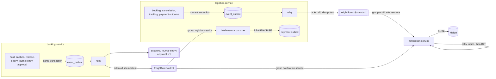

# FreightFlow: Cross-Border Logistics System

A microservices backend for a freight forwarder on the Walvis Bay (`NAWVB`, Namibia) to Hamburg (`DEHAM`, Germany) corridor.
Customers get freight quotes, book shipments and follow them through ports and customs, and every charge
settles through an internal double-entry ledger with accounts in `NAD`, `ZAR` and `EUR`.

Java 21, Spring Boot 4.1, Spring Cloud Gateway, PostgreSQL 17, Kafka, Docker. Built in phases; each phase ships
with tests, CI, architecture decision records and measured numbers.

> **Status:** Phase 4 complete: banking and logistics publish their changes as events through transactional outboxes, logistics heals holds banking expired, and notification-service emails customers in German or English, once per event. Phase 3 gave every request a Keycloak identity checked by the gateway and each service, object by object; Phase 2 paid for shipments through an authorise, capture and release saga; Phase 1 built the ledger, transfers and FX (`banking-service`) and quotes, shipments and tracking (`logistics-service`).

## Architecture

```
                    ┌──────────────────────────┐
  client ──HTTP──▶  │ api-gateway        :8080 │   routes /api/v1/**, /docs/banking/**, /docs/logistics/**
                    └─────┬───────────────┬────┘
                          │               │
             ┌────────────▼───┐       ┌───▼──────────────┐
             │ banking  :8081 │◀──────│ logistics  :8082 │   holds, captures, releases: internal, not via the gateway
             │ ledger, FX     │       │ quotes, tracking │
             └───────┬────────┘       └────────┬─────────┘
                     │                         │
              ┌──────▼──────┐           ┌──────▼──────┐
              │ banking-db  │           │ logistics-db│     one PostgreSQL per service (ADR 0001)
              └─────────────┘           └─────────────┘
                     │                         │
                     └── outbox ──▶ Kafka (KRaft, SCRAM, ACLs) ◀── outbox ──┘
                                        │            │
                                        │            └──▶ logistics (hold.expired, hold.captured)
                                        ▼
                          notification-service :8083 ──SMTP──▶ Mailpit     (Phase 4; own Postgres)
```

## Phase 4: events

banking and logistics now tell the rest of the system what happened, and notification-service emails customers about
it in German or English. Nothing is lost when the broker or a relay dies, and no customer gets the same email twice.



- **Contracts** (ADR 0023). One envelope for every event (UUIDv7 `eventId`, per-aggregate `sequence`, actor, request
  id) and a JSON Schema per type in [`docs/events/`](docs/events/), catalogued in [`docs/events.md`](docs/events.md).
  Producer tests validate every event the services write; consumer tests deserialise every example; CI refuses a
  schema change that is not compatible with `main`. JSON Schema in the repository over Avro on a registry, for the
  reasons in the ADR.
- **No personal data in events** (ADR 0024). Ids, amounts, states and codes only: a retained, replayed log is out of
  reach of an erasure request. A schema that marks or names personal data fails the build.
- **Transactional outbox** (ADR 0025) in both services: the event row commits with the change; a polling relay
  publishes with an idempotent `acks=all` producer, one event per aggregate in flight (order kept across instances),
  marks rows only after the acknowledgement and prunes them after seven days. logistics' payment commands and its
  events share one claim mechanism. Tested against a real broker: paused, a relay dying between send and mark, four
  relays racing. Measured against Debezium on the same outbox: tuned to a 50 ms poll it is about 50 ms faster
  at p50, slower to recover from an outage, and one more process per database; the relay stays.
- **logistics reacts to what banking did on its own** (ADR 0028): an expired hold on a shipment waiting for pickup is
  re-authorised; a capture logistics never asked for raises an alert metric. Payment commands stay HTTP.
- **notification-service** (ADR 0026, ADR 0027): its own Postgres; settings and history per organisation
  (`/api/v1/notification-settings`, `/api/v1/notifications`, through the gateway, matrix-tested); processed events by
  id; non-blocking retry topics, a dead-letter topic, and `/api/v1/dead-letters` to list and redrive (the operator is
  recorded); stale status events dropped by `sequence`; an email is sent at most once, even if its sender crashes.
- **Operations**: outbox backlog, age and lag, consumer lag, dead letters, emails sent and failed, each with the
  condition that should page someone ([`docs/operations.md`](docs/operations.md)).

### What it guarantees, and how it is tested

| Guarantee | Test |
| --- | --- |
| Every event matches its schema and carries no personal data | `EventContractIntegrationTest` (banking, logistics), `EventSchemaFilesTest`, `theBookingEventCarriesNothingOfTheParties`, CI "Event schemas stay compatible" |
| An event exists if and only if its change committed | the outbox row is written in the change's transaction; a replayed request writes no second event (`aReplayedRequestWritesNoSecondEvent`) |
| Broker down: events wait, nothing is lost, order holds | `eventsWaitWhileTheBrokerIsDownAndAllArriveInOrderOnceItIsBack` (paused broker, both services) |
| A relay that dies after sending sends again, never skips | `aRelayThatDiesBeforeMarkingSendsTheEventAgainAndNeverSkipsOne` |
| Racing relays keep every aggregate in order | `relaysRacingOnSeveralInstancesKeepEveryAggregateInOrder` (4 relays, 64 events) |
| A duplicate event changes nothing | `aRedeliveredExpiryChangesNothingTheSecondTime`, `aReplayedEventSendsNoSecondEmail`, CI smoke test |
| An expired hold before pickup is re-authorised | `anExpiredHoldOfAShipmentAwaitingPickupIsAuthorisedAgain` |
| A failing event is retried, dead-lettered and redriven | `aHoldEventForAnUnknownShipmentIsRetriedThenDeadLetteredAndRedrivenOnceTheShipmentIsKnown` |
| An email is never sent twice | `anEmailWhoseSenderDiedWhileSendingIsNeverSentAgain`, unique `(event_id, recipient)` |

### Example email

Rendered from the templates for a booking by Hanseatic Imports (the CI smoke test waits for this subject in Mailpit):

```
Subject: Sendung gebucht: FF-00010003-0

Guten Tag,

Ihre Sendung FF-00010003-0 von NAWVB nach DEHAM ist gebucht. Der Frachtbetrag wird auf Ihrem Konto reserviert
und erst bei Abholung belastet.

Sendungsnummer: FF-00010003-0
Strecke: NAWVB → DEHAM
Betrag: 524,75 €
Geplante Abholung: 27.11.2026

Mit freundlichen Grüßen
Ihr FreightFlow-Team
```

The same email for an English-speaking organisation says `Amount: €524.75` and `Planned pickup: 27 Nov 2026`; both
are also sent as HTML.

## Phase 3: every request has an identity

Until Phase 3 anyone who could reach the gateway could move money out of any account. Now every request carries a
Keycloak token, the gateway and each service validate it themselves, and each service checks that this caller may
touch this specific account, hold or shipment.

```mermaid
sequenceDiagram
    autonumber
    participant C as customer-namib-exports
    participant K as Keycloak
    participant G as api-gateway
    participant L as logistics-service
    participant B as banking-service
    C->>K: login (code flow + PKCE, organisation member)
    K-->>C: access token (5 min, RS256, aud gateway/banking/logistics, roles, organisation id)
    C->>G: POST /api/v1/shipments (Bearer token, Idempotency-Key)
    G->>G: validate, strip X-User-*/X-Org-*, rate limit per caller
    G->>L: same token relayed, X-Request-Id
    L->>L: validate for aud logistics-service; booking org = token's org
    L->>K: client credentials (logistics-service)
    K-->>L: token (aud banking-service, scope banking.holds)
    L->>B: POST /api/v1/holds (payerOrganizationId, onBehalfOfSubject)
    B->>B: scope banking.holds? payer account owned by that org? else 404
```

### Personas (realm `freightflow`, ADR 0016)

| Persona | Kind | What it may do |
| --- | --- | --- |
| `customer-namib-exports`, `customer-hanseatic-imports` | person, member of one organisation | its organisation's accounts, quotes and shipments only; another organisation's are a 404 |
| `operator` | person | deposits, reversals, accounts for any organisation, carrier assignment, parked payment retries |
| `auditor` | person | reads everything, changes nothing |
| `carrier-walvis-haulage` | client credentials | tracking events and reads for the shipments assigned to it |
| `logistics-service` | client credentials | holds in banking, and nothing else (scope `banking.holds`) |

```bash
python scripts/generate_secrets.py                  # once: passwords and client secrets into secrets/
scripts/token.sh customer-namib-exports             # a real access token on stdout
scripts/token.sh operator --claims                  # the decoded claims
TOKEN=$(scripts/token.sh customer-namib-exports)
curl -H "Authorization: Bearer $TOKEN" http://127.0.0.1:8080/api/v1/shipments
```

### What it guarantees, and how it is tested
- **No endpoint answers without a valid token** except the public tracking view and health; a request sent straight
  to a service, around the gateway, is refused too: each service validates the token for its own audience (ADR 0017).
- **Object-level authorisation** (OWASP API1, ADR 0018): the policy table below is data in each service's
  `AuthorisationMatrixTest`, run for every endpoint, role and own/foreign object (208 cases in banking, 91 in
  logistics). A foreign object is the same 404 as a missing one.
- **Service-to-service credentials** (ADR 0019): holds need logistics' own client-credentials token. With Keycloak
  paused, payment commands stay pending and nothing is lost or duplicated (`BankingFaultInjectionTest`).
- **Caller-scoped idempotency and audit actors** (ADR 0020): two tenants with the same key never collide; every
  journal entry, hold, booking, cancellation, tracking event and payment retry records who made it.
- **The edge**: forgeable identity headers stripped, per-caller rate limits on money-moving routes failing closed,
  401/403/429/503 problems, security events logged without tokens. **Secrets** only in `secrets/`, compose secrets
  and the config tree; no default in `application.yml`; only the gateway and Keycloak publish a port.
- **STRIDE threat model** per trust boundary, each threat mapped to its control and test: [`docs/threat-model.md`](docs/threat-model.md).

| Endpoint | Customer (own / foreign) | Operator | Auditor | Carrier (assigned) | logistics-service | Anonymous |
| --- | --- | --- | --- | --- | --- | --- |
| Accounts, statements, FX quotes, journal entries | own / 404 | all | read | 403 | 403 | 401 |
| Transfers | own / 404 | 403 (ADR 0021) | read | 403 | 403 | 401 |
| Deposits, reversals: request / approve (four eyes, ADR 0021) | 403 | request; approve only another's | read | 403 | 403 | 401 |
| Reconciliation, payment commands | 403 | yes | read | 403 | 403 | 401 |
| Holds (internal) | 403 | 403 | 403 | 403 | yes | 401 |
| Quotes, shipments, cancellations | own / 404 | all | read | read (assigned) | 403 | 401 |
| Tracking events | 403 | yes | 403 | assigned only (else 404) | 403 | 401 |
| Public tracking | yes | yes | yes | yes | yes | yes |

The full table, row by row, is in [ADR 0018](docs/adr/0018-object-level-authorisation.md).

## Phase 2: paying for a shipment

Booking a shipment reserves its freight on the customer's account; pickup takes it; a cancellation gives it back.
The two services share no database (ADR 0001), so the payment is a saga through a transactional outbox, made safe to
retry by idempotency keys (ADR 0012).

```mermaid
sequenceDiagram
    autonumber
    participant C as Client
    participant G as api-gateway
    participant L as logistics-service
    participant LDB as logistics-db
    participant B as banking-service
    C->>G: POST /api/v1/shipments (Idempotency-Key)
    G->>L: forward (X-Request-Id)
    L->>LDB: one transaction: shipment AWAITING_PAYMENT + AUTHORISE command
    L-->>C: 201 AWAITING_PAYMENT
    loop relay, every 500 ms, any instance (FOR UPDATE SKIP LOCKED)
        L->>B: POST /api/v1/holds (Idempotency-Key: shipment-<id>-authorise)
        alt hold accepted
            B-->>L: 201 hold (available balance drops)
            L->>LDB: shipment BOOKED
        else refused (insufficient funds, unknown account)
            B-->>L: 409 / 404 problem
            L->>LDB: shipment PAYMENT_FAILED, problem recorded, no retry
        else timeout, reset, 5xx: outcome unknown
            L->>LDB: retry later with the SAME key (banking replays a committed hold)
        end
    end
    Note over L,B: PICKED_UP (or a later scan) enqueues CAPTURE; cancelling a BOOKED shipment enqueues RELEASE
    L->>B: POST /api/v1/holds/{id}/capture (shipment-<id>-capture)
    B-->>L: 200: one CAPTURE entry, payer to FREIGHT_REVENUE
```

### What it guarantees, and how it is tested
- **Exactly one hold per shipment, whatever is lost.** `BankingFaultInjectionTest` runs the real banking-service
  image behind Toxiproxy: banking slower than the read timeout, banking down, the connection cut after banking
  committed, 503 while banking's database is paused, and the circuit breaker opening and closing. Each test ends by
  asking banking for the shipment's holds (exactly one) and its reconciliation (clean).
- **The customer never overdraws through holds**: `available = ledger balance - active holds`, enforced by a `CHECK`
  and by every debit. Concurrent capture and release of one hold resolve to exactly one (ADR 0011).
- **Banking owns FX.** A hold in another currency converts at banking's rate, locked on the hold and used by the
  capture through the `FX_POSITION` accounts. Quotes are priced in the tariff currency; any other figure is
  indicative and comes from banking.
- **Contracts on both sides.** banking's OpenAPI document is committed (`docs/api/banking-openapi.json`) and a test
  fails when the served one drifts; logistics validates every banking stub against it (ADR 0014).
- **Resilience** (ADR 0013): 500 ms connect, 2 s read, 2 in-call retries only for unknown outcomes inside a 5 s budget,
  a circuit breaker and bulkheads, then durable retries with backoff and parking for an operator.
- **The edge** (ADR 0015): internal paths answer 404, 15 s response timeout, 1 MB bodies, GET-only retries,
  `X-Request-Id` on every request and in every service's logs, and RFC 9457 problems for the gateway's own errors.

### Example: book, get paid, pick up

```bash
# Book: 201 AWAITING_PAYMENT; the relay authorises a hold a moment later
curl -s -X POST http://127.0.0.1:8080/api/v1/shipments -H "Content-Type: application/json" \
  -H "Idempotency-Key: book-42" -d '{"quoteId":"<quote id>","payerAccountNumber":"<EUR account>", ...}'

curl -s http://127.0.0.1:8080/api/v1/shipments/<id>
```

```json
{
  "status": "BOOKED",
  "payment": {
    "status": "AUTHORISED",
    "holdId": "01a1c913-fe17-7bc2-8c0a-10083c143d55",
    "amount": 524.75,
    "currency": "EUR",
    "failureType": null,
    "failureDetail": null
  }
}
```

```bash
# The payer's account: ledger balance unchanged, available balance reduced by the hold
curl -s http://127.0.0.1:8080/api/v1/accounts/<EUR account>
# {"ledgerBalance": 5000.00, "availableBalance": 4475.25, ...}

# A missed pickup scan: the departure skips two milestones, is applied, and triggers the capture
curl -s -X POST http://127.0.0.1:8080/api/v1/shipments/<id>/tracking-events -H "Content-Type: application/json" \
  -d '{"carrierEventId":"VSL-1","eventType":"DEPARTED","targetStatus":"IN_TRANSIT","location":"NAWVB",
       "description":"Vessel departed","occurredAt":"2026-04-21T06:00:00Z"}'
# {"outcome":"APPLIED","skippedStatuses":["PICKED_UP","AT_ORIGIN_PORT"], ...}  then payment.status CAPTURED

# Internal endpoints are not reachable at the edge
curl -s -X POST http://127.0.0.1:8080/api/v1/holds
# 404 {"type":"https://freightflow.dev/problems/not-found", ...}
```

The full walkthrough is `scripts/smoke_test.sh` (49 calls, run in CI against the default stack).

## Engineering highlights (Phase 1)

- **Append-only double-entry ledger ([ADR 0004](docs/adr/0004-double-entry-append-only-ledger.md))**: Every balance change is recorded as a balanced journal entry (`SUM(postings) = 0` per currency) enforced by a `DEFERRABLE INITIALLY DEFERRED` PostgreSQL constraint trigger (`trg_verify_journal_entry_balanced`). `BEFORE UPDATE OR DELETE` triggers block in-place mutations on `journal_entries` and `postings`; corrections happen only via one-time compensating `REVERSAL` entries.
- **Deadlock-free concurrent transfers ([ADR 0005](docs/adr/0005-transfer-concurrency-strategy.md))**: Participating accounts are locked in ascending UUIDv7 order (`SELECT ... WHERE id IN (:ids) ORDER BY id ASC FOR UPDATE`) after evicting pre-lock JPA 1st-level cache snapshots. Verified under 200 concurrent drains on 1 account, 100 concurrent `A -> B` / `B -> A` pairs (0 `40P01` deadlocks), and 20 concurrent identical `Idempotency-Key` requests.
- **Transactional idempotency keys ([ADR 0006](docs/adr/0006-idempotency-keys.md))**: Implements `draft-ietf-httpapi-idempotency-key-header-08` using `pg_advisory_xact_lock(hashtext(scope), hashtext(key))` and canonical SHA-256 request hashes stored in the same ACID transaction (`422` on payload mismatch, `409` + `Retry-After: 1` when in flight, `Idempotent-Replayed: true` on replay).
- **Exact decimal money, CMA peg & 4-posting FX transfers ([ADR 0007](docs/adr/0007-money-rounding-and-fx-quotes.md))**: `NUMERIC(19,4)` amounts, `NUMERIC(19,8)` FX rates, `RoundingMode.HALF_EVEN` to ISO 4217 minor units, 1:1 `NAD`/`ZAR` Common Monetary Area peg, and locked FX quotes (`POST /api/v1/fx-quotes`) settled via 4 postings through `FX_POSITION` accounts so every currency balances to zero.
- **Industry chargeable weight & Incoterms 2020 ([ADR 0008](docs/adr/0008-freight-quotes-and-chargeable-weight.md))**: `AIR` volumetric weight ($\text{cm}^3 / 6000$, IATA Resolution 502) and `SEA_LCL` revenue ton ($\max(\text{t}, \text{m}^3)$ W/M) with immutable tariff snapshotting and `EXW`/`FCA`/`DAP`/`DDP` responsibility allocation.
- **Explicit shipment state machine, out-of-order tracking & `ETag`/`If-Match` ([ADR 0009](docs/adr/0009-shipment-state-machine-and-tracking.md))**: Crockford Base32 tracking numbers (`FF-<8 chars>-<check>`) with ISO 7064 MOD 37-2 check character; late/out-of-order carrier scans (`occurredAt < latestEventAt`) are recorded in history with `appliedToStatus = false` without reverting shipment status; public tracking converts timestamps into each location's IANA time zone (`Africa/Windhoek`, `Europe/Berlin`) and strips customer PII.
- **Keyset pagination verified with `EXPLAIN (ANALYZE, BUFFERS)`**: Statement pagination reads 4 buffer pages in `0.110 ms` at `90,688` postings; shipment listing reads 7 buffer pages in `0.163 ms` at `20,000` shipments.
- **RFC 9457 Problem Details everywhere**: Every validation and domain error returns `application/problem+json` with a stable `type` URI documented in [`docs/problems.md`](docs/problems.md).

## Tech stack

| Area | Technology |
| --- | --- |
| Language, framework | Java 21, Spring Boot 4.1 |
| Edge | Spring Cloud Gateway 5 (WebFlux) |
| Persistence | PostgreSQL 17, Spring Data JPA, Flyway |
| Messaging | Apache Kafka 4 in KRaft mode (Phase 4) |
| API docs | springdoc-openapi, Swagger UI (`/docs/banking/swagger-ui.html`, `/docs/logistics/swagger-ui.html`) |
| Tests | JUnit 5, Mockito, Testcontainers, JaCoCo (`>= 80%` line / `>= 70%` branch gate), k6 |
| Delivery | Docker multi-stage layered images, Docker Compose, GitHub Actions |
| Supply chain | gitleaks, Trivy image scan, SPDX SBOM, Dependabot |

## Quickstart

Needs Docker and JDK 21 (only for running tests outside Docker). No local Maven: every service has a wrapper.

```bash
cp .env.example .env              # non-secret settings
python scripts/generate_secrets.py   # every password and client secret, into the git-ignored secrets/
docker compose up -d --build --wait
curl http://127.0.0.1:8085/actuator/health   # the gateway's management port
./scripts/seed_demo.sh            # as the personas: accounts, FX transfer and a shipment
./scripts/smoke_test.sh           # the whole flow as every persona, refusals included
docker compose --profile debug up -d   # optional: publish services and databases on 127.0.0.1 for local tools
```

Interactive OpenAPI docs through the gateway:
- **Banking API**: `http://127.0.0.1:8080/docs/banking/swagger-ui.html`
- **Logistics API**: `http://127.0.0.1:8080/docs/logistics/swagger-ui.html`
- **Full curl walkthrough**: [`docs/smoke-test.md`](docs/smoke-test.md)

The default stack includes Kafka, with a SCRAM user per service and ACLs (ADR 0022). Measured with `docker stats`
after the smoke test, on the benchmark laptop's Docker Desktop VM (3.695 GiB): 2284 MiB in total, so about 1.4 GiB
free. Keycloak 516 MiB, logistics 494 MiB, banking 391 MiB, Kafka 365 MiB, gateway 306 MiB, the three Postgres
databases 198 MiB together, Redis 15 MiB. Kafka's heap is capped at 512 MB; nothing else was trimmed.

## Phase 1 API examples (via `:8080`)

Every call below needs `-H "Authorization: Bearer $(scripts/token.sh <persona>)"` since Phase 3: an operator opens
accounts (`{"currency":"NAD","organizationId":"<organisation id>"}`) and deposits; a customer quotes, transfers and
books. The examples show the bodies; [`docs/smoke-test.md`](docs/smoke-test.md) has the full, authenticated walkthrough.

### 1. Open an account, deposit funds & execute a cross-currency FX transfer

```bash
# Open a NAD exporter account (ISO 7064 MOD 97-10 check digits)
curl -s -X POST http://127.0.0.1:8080/api/v1/accounts \
  -H "Authorization: Bearer $(scripts/token.sh operator)" -H "Content-Type: application/json" \
  -d '{"currency":"NAD","organizationId":"0193a0e0-0000-7000-8000-00000000a001"}'
```

```json
{
  "id": "01a1ba5f-f074-7e31-a07e-7fb5fead5078",
  "accountNumber": "FF20NAD000001401",
  "ownerOrganizationId": "0193a0e0-0000-7000-8000-00000000a001",
  "type": "CUSTOMER",
  "currency": "NAD",
  "status": "ACTIVE",
  "balance": 0.00
}
```

```bash
# Lock a 5-minute FX quote (50,000.00 NAD -> EUR)
curl -s -X POST http://127.0.0.1:8080/api/v1/fx-quotes \
  -H "Content-Type: application/json" \
  -d '{"sellCurrency":"NAD","buyCurrency":"EUR","sellAmount":50000.00}'
```

```json
{
  "id": "01a1ba60-0961-7a53-8519-ec54986c624b",
  "sellCurrency": "NAD",
  "buyCurrency": "EUR",
  "sellAmount": 50000.00,
  "buyAmount": 2487.50,
  "midRate": 0.05000000,
  "spread": 0.005000,
  "rate": 0.04975000,
  "consumed": false
}
```

### 2. Quote ocean freight (`NAWVB -> DEHAM`), book a shipment & track across time zones

```bash
# Quote 2 pallets of frozen hake (120x100x150 cm, 500 kg each -> 3.6000 CBM / 1.0 t -> 3.6 WM_TON)
curl -s -X POST http://127.0.0.1:8080/api/v1/quotes \
  -H "Content-Type: application/json" \
  -d '{
    "origin": "NAWVB",
    "destination": "DEHAM",
    "mode": "SEA_LCL",
    "incoterm": "FCA",
    "payerRole": "CONSIGNEE",
    "packages": [{"lengthCm":120,"widthCm":100,"heightCm":150,"weightKg":500,"quantity":2,"description":"Frozen hake fillets"}]
  }'
```

```json
{
  "id": "01a1ba60-1fc7-711b-b006-c4e7c35d8af5",
  "origin": "NAWVB",
  "destination": "DEHAM",
  "mode": "SEA_LCL",
  "incoterm": "FCA",
  "payerRole": "CONSIGNEE",
  "billingUnit": "WM_TON",
  "actualWeightKg": 1000.000,
  "volumeCbm": 3.6000,
  "chargeableWeightKg": 3600.000,
  "chargeableUnits": 3.6000,
  "currency": "EUR",
  "baseFreightCharge": 342.00,
  "fuelSurcharge": 42.75,
  "destinationHandlingCharge": 85.00,
  "importClearanceCharge": 55.00,
  "totalAmount": 524.75
}
```

```bash
# Public tracking by Crockford Base32 tracking number (local IANA time zones, zero customer PII)
curl -s http://127.0.0.1:8080/api/v1/shipments/track/FF-00010000-6
```

## Benchmarks

Measured on an Intel Core i5-1135G7 laptop (4 cores / 8 threads), Windows 11 10.0.26300, Docker Desktop on WSL 2
(8 CPUs, 3.7 GiB), with the host at about 90% CPU from other applications, PostgreSQL 17, Temurin 21, HikariCP pool 32.
Every run ends with a balanced ledger reconciliation. The reports hold the method, every round and the caveats.

| Report | Question | Result |
| --- | --- | --- |
| [Transfer contention](docs/benchmarks/transfer-contention.md) | `pessimistic` vs `conditional-update` transfers (ADR 0005) | Ranges overlap in every workload on this machine; `pessimistic` stays the default because one ordered lock covers every entry shape, FX included |
| [Hot system accounts](docs/benchmarks/hot-accounts.md) | `locked` vs `unlocked` vs `sharded` system postings (ADR 0010) | Deposits at 32 VUs: 6.0-10.7/s `locked`, 22.5-24.6/s `unlocked`, no overlap; `unlocked` is the default |
| [Payment flow](docs/benchmarks/payment-flow.md) | Time from booking to `BOOKED` through the relay (ADR 0012) | Parallel relay at 16 VUs: 11.5 booked/s, p99 5.2 s, up from 1.9/s and 26.3 s with the sequential relay |
| [System balance read](docs/benchmarks/hot-accounts.md#reading-an-unlocked-balance-at-a-million-postings-phase-3) | Reading an unlocked system balance at 1,000,000 postings (ADR 0010) | 175 ms median without a checkpoint, 0.48 ms with one |
| [Cold start](docs/benchmarks/cold-start.md) | First requests through the gateway after a restart, before and after the warm-up | First banking request 1.7-3.4 s before, 159-306 ms after; first quote 2.0-4.2 s before, 0.7-2.6 s after |

On a GitHub-hosted runner (Xeon 6975P-C, 4 vCPUs, 15.3 GiB; run 44744962828, Phase 4 code) each report now opens
with its hosted numbers: `conditional-update` ahead of `pessimistic` in every workload, `unlocked` deposits at 182.5/s
against 123.3/s `locked` at 32 VUs, 25.0 shipments booked/s at 16 VUs with p99 0.79 s to `BOOKED`, and a 0.30 ms
checkpointed balance read. Phase 4 adds [Events](docs/benchmarks/events.md): booking to the customer's German email
p50 368 ms, p95 618 ms, p99 658 ms at 2 bookings/s; outbox lag p95 at most 224 ms; a 30 s broker outage under load
drained 7.7 s after the restart, with every email delivered. Debezium reading the same outbox: p50 53 ms against the relay's 106 ms at a 50 ms poll,
507 ms on its 500 ms default.

The table above is laptop numbers. `.github/workflows/benchmarks.yml` runs the same workloads on a GitHub-hosted runner and
records its CPU and memory; its results lead the reports once it has run.

## Running the tests

```bash
cd banking-service && ./mvnw verify       # banking-service: 268 tests (unit, Testcontainers, concurrency, contract, authorisation matrix)
cd logistics-service && ./mvnw verify     # logistics-service: 264 tests (unit, Testcontainers, contract, Toxiproxy faults, real Keycloak, authorisation matrix)
cd api-gateway && ./mvnw verify           # api-gateway: 58 tests (edge policy, JWT validation, issuer outage, rate limits)
```

Integration tests start their own PostgreSQL 17 in Testcontainers, so Docker must be running. The logistics fault-injection tests also run the `freightflow-banking-service` image, so build it first (`docker compose build banking-service`), and start a real Keycloak; on a 3.7 GiB Docker VM stop the compose stack while they run. Every service enforces a JaCoCo coverage gate (`>= 80%` line, `>= 70%` branch).

## Roadmap

| Phase | Scope | Status |
| --- | --- | --- |
| 0 | Scaffold: standalone services, compose, CI with scans and SBOMs, first ADRs | Done |
| 1 | Ledger and shipments core: double-entry ledger, idempotent transfers, FX quotes, freight quotes, shipment state machine | Done |
| 2 | Settlement across services: holds, payment saga, resilient HTTP client, contract and fault-injection tests, edge policy | Done |
| 3 | Security: Keycloak with organisations, token relay validated in every service, object-level authorisation, service-to-service credentials, caller-scoped idempotency, audit actors, threat model | Done |
| 4 | Events: transactional outbox, Kafka with SCRAM and ACLs, JSON Schema contracts, notification service in German and English, retry and dead-letter topics, four-eyes approvals | Done |
| 5 | Observability: OpenTelemetry traces, metrics and logs, Grafana dashboards, SLOs and alerts | Next |
| 6 | Real-world data: live exchange rates, customs duties and Incoterms, carrier tracking feeds | Planned |
| 7 | Hardening: load and chaos tests, TLS and mTLS, cloud deployment | Planned |

## Repository layout

```
api-gateway/            Spring Cloud Gateway (:8080)
banking-service/        accounts, double-entry ledger, transfers, FX quotes (:8081)
logistics-service/      freight quotes, shipments, tracking events (:8082)
notification-service/   event consumer (:8083, Phase 4)
benchmarks/             k6 scripts and the Python harness for the transfer, hot-account and payment benchmarks
scripts/seed_demo.sh    end-to-end demo data seeder through the gateway
scripts/smoke_test.sh   end-to-end smoke test, stops at the first unexpected status
scripts/token.sh        a real token for a demo persona (ADR 0016)
scripts/generate_secrets.py  every secret, into the git-ignored secrets/ (ADR 0019)
docs/adr/               architecture decision records (0001-0020)
docs/threat-model.md    STRIDE per trust boundary, threats mapped to controls and tests
infra/keycloak/         the Keycloak image and the freightflow realm (ADR 0016)
docs/api/               banking's committed OpenAPI contract (ADR 0014)
docs/benchmarks/        measured benchmark reports
docs/problems.md        RFC 9457 Problem Details type URI registry
docs/smoke-test.md      end-to-end gateway curl walkthrough
.github/                CI and Dependabot
```

## Engineering conventions

The reasons behind the big decisions are in [docs/adr](docs/adr/README.md).

Built by Parata Kativa.
