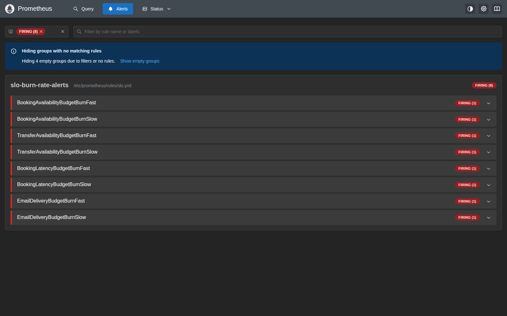
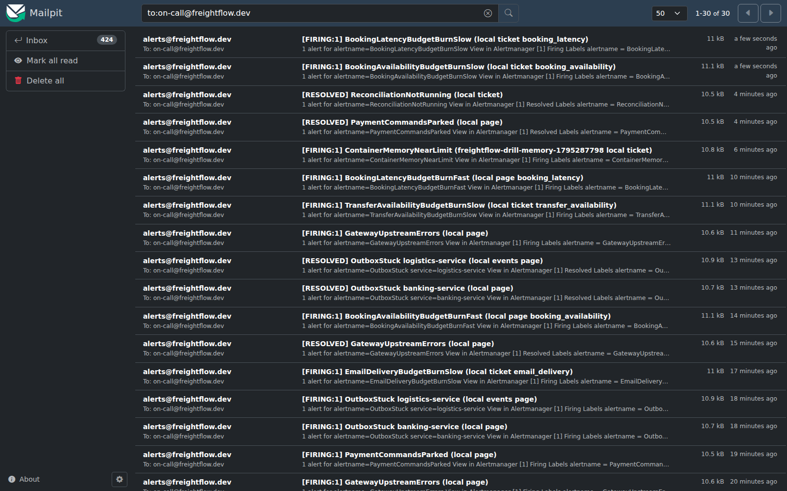

# Service level objectives and alerts

What customers feel, measured where it happens, and when a person is told (ADR 0033). The rules are files:
`infra/observability/rules/slo.yml` (generated from the objectives below by `generate_slo_rules.py`) and
`symptoms.yml`, each alert with a promtool test in `rules/tests/`, a runbook in [runbooks/](runbooks/README.md), and a
run of the [fire drill](#fire-drill).

## Objectives

All over a rolling 28 days. The numbers come from the hosted-runner benchmarks (GitHub `ubuntu-24.04`, 4 vCPUs,
15.6 GiB; docs/benchmarks/), which say what the system does when it works, and leave room for the laptop and for a cold
start.

| SLO | SLI (good / all) | Objective | Budget | Measured | Why this number |
| --- | --- | ---: | ---: | --- | --- |
| Bookings succeed | `POST /api/v1/shipments` in logistics, not 5xx | 99.5 % | 0.5 % (3.4 h of full outage) | 0 server errors in 240 bookings at 2/s and 600 at up to 25/s, a broker outage included | A booking is the start of revenue; a 4xx (a bad request, a refused token) is the caller's, not ours. 99.5 rather than 99.9: one Postgres per service on one host, restarts and upgrades included |
| Transfers succeed | `POST /api/v1/transfers` in banking, not 5xx | 99.5 % | 0.5 % | No transfer failed in the contention benchmark (0 `409`, 0 `503`, docs/benchmarks/transfer-contention.md); a lock timeout would answer 503 and count against it | The same reasoning; the four-eyes and idempotency rules make a retried transfer safe, so a short outage costs a retry, not money |
| Bookings are fast | `POST /api/v1/shipments` in logistics answered within 500 ms | 95 % | 5 % | p95 41.6 ms at 13.5 bookings/s, 49.7 ms at 25/s; first request after a cold start up to 890 ms p95 for a quote | Ten times the measured p95, so a slow laptop or a GC does not page; a booking that takes longer than half a second is one a person notices |
| Booking to email | Emails accepted by the mail server within 60 s of the booking's commit (`freightflow_emails_end_to_end_seconds`, from the event's UUIDv7 time) | 99 % | 1 % | p99 669 ms; after a 30 s broker outage the last email arrived 6.6 to 12.2 s after the restart | An email is a notification, not a transaction: a minute is still "at once" for a customer, and covers a broker or mail server restart; a longer wait is a customer asking support where their confirmation is |

**Not an objective: the ledger reconciles, always.** Drift (an account's stored balance different from its postings, or
a currency whose postings do not sum to zero) is never acceptable, so it is a hard alert (`LedgerDrift`, page, no
grace period), checked every 5 minutes by `ReconciliationMonitor` and whenever an operator asks for the report. That the
check runs is alerted too (`ReconciliationNotRunning`).

**Where the SLIs are measured.** At the service, not the gateway: Spring Cloud Gateway's request metrics carry the
route, not the path, so the gateway cannot tell a booking from a quote. A failure the services cannot see (a service
down, Keycloak unreachable) shows in `GatewayUpstreamErrors` and `ServiceDown`.

## Burn-rate alerts

The multi-window, multi-burn-rate method of the Google SRE workbook (chapter 5): an alert fires when the budget burns
fast in a long window and is still burning in a short one, so it pages early for a real problem and resets soon after
the problem ends.

| Alert | Long window | Short window | Burn rate | Budget used when it fires | Severity | `for` |
| --- | --- | --- | ---: | --- | --- | --- |
| `...BudgetBurnFast` | 1 h | 5 m | 14.4 | 2 % in an hour | page | 2 m |
| | 6 h | 30 m | 6 | 5 % in 6 hours | page | 2 m |
| `...BudgetBurnSlow` | 1 d | 2 h | 3 | 10 % in a day | ticket | 15 m |
| | 3 d | 6 h | 1 | 10 % in 3 days | ticket | 15 m |

For each of the four SLOs: `BookingAvailability`, `TransferAvailability`, `BookingLatency`, `EmailDelivery`. Each SLI is
a recording rule per window (`slo:<name>:error_ratio_rate<window>`).

## Symptom alerts

| Alert | Condition | Severity | Runbook |
| --- | --- | --- | --- |
| `LedgerDrift` | any account discrepancy or unbalanced currency | page | [ledger-drift](runbooks/ledger-drift.md) |
| `ReconciliationNotRunning` | no reconciliation for 15 min, for 5 min | ticket | [ledger-drift](runbooks/ledger-drift.md) |
| `PaymentCommandsParked` | a payment command out of attempts, for 2 min | page | [payment-commands-parked](runbooks/payment-commands-parked.md) |
| `ApprovalsNearExpiry` | an approval expiring within the hour, for 5 min | ticket | [approvals-near-expiry](runbooks/approvals-near-expiry.md) |
| `OutboxStuck` | an outbox's oldest unsent row older than 60 s, for 2 min | page | [outbox-stuck](runbooks/outbox-stuck.md) |
| `ConsumerLagHigh` | a group more than 100 records behind on a topic, for 5 min | ticket | [consumer-lag](runbooks/consumer-lag.md) |
| `DeadLettersWaiting` | a dead letter not yet redriven, for 5 min | ticket | [dead-letters](runbooks/dead-letters.md) |
| `EmailsUnknown` | an email in UNKNOWN, for 1 min | ticket | [emails-unknown](runbooks/emails-unknown.md) |
| `EmailsFailing` | an email refused on every attempt in the last 15 min | ticket | [emails-failing](runbooks/emails-failing.md) |
| `ServiceDown` | a service or Keycloak not answering its scrape, for 1 min | page | [service-down](runbooks/service-down.md) |
| `GatewayUpstreamErrors` | over 5 % of the gateway's requests 5xx, for 5 min | page | [service-down](runbooks/service-down.md) |
| `ContainerMemoryNearLimit` | a container above 90 % of its memory limit, for 10 min | ticket | [container-memory](runbooks/container-memory.md) |

**Not alerted: certificate and signing-key expiry.** Inside compose there is no TLS (docs/threat-model.md: Phase 7),
and Keycloak's realm keys are generated RSA keys without an expiry; Keycloak rotates them by adding a key, and the
services fetch the new one by its `kid`. When TLS arrives, a certificate-expiry alert comes with it.

**Routing.** Alertmanager sends every alert as an email to the on-call address (Mailpit in the local stack); a page
repeats hourly, a ticket every 12 hours. `ServiceDown` inhibits the other alerts of the same service, so a crashed
service pages once.

## Fire drill

`scripts/alert_fire_drill.py` (the Actions workflow "Alert fire drill") makes every alert fire once against the whole
stack: it changes an account's balance, stops Mailpit and notification-service while bookings continue, publishes a
hold event for a shipment notification has not seen, stops banking's database while transfers continue, stops Kafka,
stops and then pauses logistics' database while bookings continue, and fills a container to 92 % of its memory limit.
It then undoes each and waits for the alerts to resolve. Two conditions are simulated in the database, because causing
them for real takes a crash at an exact moment or minutes of backoff: a parked payment command and an email in UNKNOWN.
Their fixes are the real operator actions (a retry, a resend with the duplicate acknowledged, a redrive). The
slow-burn alerts fire, and by design keep firing for hours after the burn; their recovery is in the promtool tests.

The drill's first runs found two faults the unit tests had not. Table gauges queried the database on every scrape, so
with a database down the scrape timed out and the request metrics of that very outage went missing (`BoundedGauge`
since, ADR 0031). And Tempo's search returns trace ids without leading zeros, which the CI trace check now pads.

### Evidence

Run [44938342018](https://github.com/tsegale/cross-border-logistics-system/actions/runs/44938342018), 2026-11-21,
GitHub-hosted runner (AMD EPYC 7763, 4 vCPUs, 15,983 MiB), 19:03:18 to 19:48:53 UTC, **passed: every one of the 20
alerts fired, and every symptom alert resolved**; Alertmanager sent 30 emails to the on-call address.
Times UTC.

| Alert | Caused by | Fired | Resolved |
| --- | --- | --- | --- |
| LedgerDrift | an account's balance changed by 1.0000 | 19:03:48 | 19:04:18 |
| EmailsFailing | Mailpit stopped while bookings went on | 19:05:48 | 19:21:48 |
| ServiceDown | notification-service stopped | 19:08:18 | 19:17:08 |
| ConsumerLagHigh | notification-service stopped | 19:15:58 | 19:17:18 |
| EmailDeliveryBudgetBurnFast | the emails both delayed | 19:19:08 | (burn-rate, see below) |
| EmailsUnknown | an email left SENDING (simulated) | 19:20:28 | 19:22:58, after an operator's resend |
| DeadLettersWaiting | hold.released for a shipment not yet seen | 19:22:48 | 19:23:28, after the shipment's booking and a redrive |
| ReconciliationNotRunning | banking without its scheduled reconciliation | 19:24:48 | 19:43:59, banking restored |
| TransferAvailabilityBudgetBurnFast | banking's database stopped under transfers | 19:25:58 | (burn-rate, see below) |
| GatewayUpstreamErrors | the outages behind the gateway | 19:28:38 | 19:48:49 |
| PaymentCommandsParked | a booking's AUTHORISE parked (simulated) | 19:29:28 | 19:43:59, after an operator's retry |
| OutboxStuck | Kafka stopped while bookings went on | 19:30:28 | 19:31:48 |
| EmailDeliveryBudgetBurnSlow | as the fast burn | 19:32:08 | (burn-rate, see below) |
| ApprovalsNearExpiry | an approval due in 20 minutes | 19:32:28 | 19:32:48, after a second operator approved |
| BookingAvailabilityBudgetBurnFast | logistics' database stopped under bookings | 19:35:08 | (burn-rate, see below) |
| TransferAvailabilityBudgetBurnSlow | as the fast burn | 19:38:58 | (burn-rate, see below) |
| BookingLatencyBudgetBurnFast | logistics' database paused under bookings | 19:38:58 | (burn-rate, see below) |
| ContainerMemoryNearLimit | a container held at 92 % of its 64 MiB | 19:42:49 | 19:48:39, container removed |
| BookingAvailabilityBudgetBurnSlow | as the fast burn | 19:48:09 | (burn-rate, see below) |
| BookingLatencyBudgetBurnSlow | as the fast burn | 19:48:29 | (burn-rate, see below) |

The eight burn-rate alerts were still firing at the end, as the method intends: a fast burn keeps firing until its
30-minute window is clean (up to 30 minutes after the outage), a slow burn until its 2-hour or 6-hour one is. Their
clearing is proved by promtool instead (`slo.test.yml`, "recovers": an hour of burning, then 100 minutes of healthy
traffic, and the fast alert has cleared). Five earlier runs failed and each found something: the table gauges that
blinded scrapes in an outage, drill triggers that did not trigger (a 400 instead of a 503, a quote failing before the
booking), and a background load that hid an outage inside the hour's budget.

