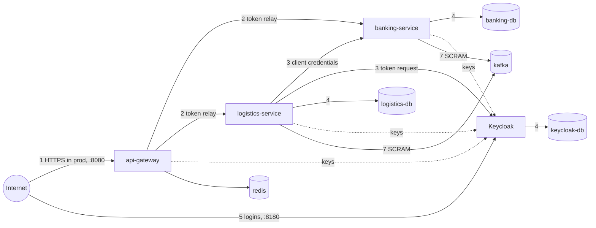

# Threat model (Phase 3; insider misuse and the broker added in Phase 4)

STRIDE per trust boundary. Every threat names the control that stops it and the test or check that proves the
control works. "Residual" is what remains, and where it is addressed.

## 1. Internet to gateway

| STRIDE | Threat | Control | Proof |
| --- | --- | --- | --- |
| Spoofing | Request without a token, or with a forged, expired, wrongly signed or wrong-audience token | Resource server: RS256 only, issuer, audience `api-gateway`, lifetime (ADR 0017) | `GatewaySecurityTest.tokensThatAreNotExactlyRightAre401` (unknown key, other issuer, other audience, expired, HS256, `alg: none`) |
| Spoofing | Client sends `X-User-Id`, `X-Org-Id`, `X-Roles` to impersonate | Forgeable identity headers stripped before routing; services never read identity from headers | `GatewaySecurityTest.forgedIdentityHeadersAreStrippedAndTheTokenIsRelayedUnchanged` |
| Tampering | Oversized or slow bodies to exhaust memory | 1 MB body limit, 15 s response timeout (ADR 0015) | `GatewayEdgeTest` |
| Repudiation | Customer denies a transfer | Actor on every journal entry and hold, request id end to end (ADR 0020) | `AuthorisationMatrixTest.everyMoneyMovementRecordsWhoMadeItAndOnlyStaffSeeIt` (banking) |
| Information disclosure | Error bodies leak internals; 401 explains why a token failed | RFC 9457 problems without stack traces; `WWW-Authenticate` with an error code only | `GatewayProblemHandlerTest`, `GatewaySecurityTest` |
| Information disclosure | Public tracking leaks customer data | Tracking view without parties, payer or values (ADR 0009) | smoke test `expect .shipper ""` |
| Denial of service | A caller floods money-moving routes | Per-caller Redis token buckets, fail closed (ADR 0017) | `RateLimitTest`, `RateLimitRedisDownTest` |
| Denial of service | Forged key ids make the gateway hammer Keycloak | Unknown key ids refetch at most once per 30 s | `IssuerOutageTest.unknownKeyIdsDoNotRefetchTheKeysAgainWithinTheMinimumInterval` |
| Elevation of privilege | A customer calls an operator route | Edge role rules, then the service's own rules | `GatewaySecurityTest.coarseRoleRulesAtTheEdge` |

Residual: plain HTTP in compose. Production terminates TLS in front of the gateway (ADR 0019).

## 2. Gateway to services

| STRIDE | Threat | Control | Proof |
| --- | --- | --- | --- |
| Spoofing | A container on the network calls a service directly with forged identity | Each service validates the token itself, for its own audience (ADR 0017) | both `AuthorisationMatrixTest`s: every endpoint anonymous is 401 |
| Spoofing | A carrier's token used against banking directly | Carrier tokens have no `banking-service` audience (ADR 0016) | `KeycloakRealmIntegrationTest.aCarrierTokenNamesTheGatewayAndLogisticsButNeverBanking` |
| Elevation of privilege | BOLA: a customer changes an id to reach another tenant's object | Ownership checked on the loaded object; foreign is 404 (ADR 0018) | both `AuthorisationMatrixTest`s (299 cases) |
| Information disclosure | Lists include other tenants' shipments | Visibility in the query | `AuthorisationMatrixTest.listsOnlyShowWhatTheCallerMaySee` |
| Tampering | Idempotency key reuse across tenants returns another tenant's response | Keys scoped to the caller (ADR 0020) | `AuthorisationMatrixTest.sameKeyFromTwoTenantsIs...` (both services) |
| Denial of service | Keycloak down makes services answer 500 or 401 | 503 `issuer-unavailable` when keys cannot be fetched | `IssuerOutageTest`; `IssuerOutageFilter` in both services |

Residual: no mTLS between containers locally; Phase 7.

## 3. logistics-service to banking-service, and to Keycloak

| STRIDE | Threat | Control | Proof |
| --- | --- | --- | --- |
| Spoofing | Anyone on the network authorises or captures holds | Holds need logistics' token with scope `banking.holds` (ADR 0019) | banking `AuthorisationMatrixTest` hold rows: every other caller 403 |
| Elevation of privilege | A booking reserves another organisation's money | Hold carries `payerOrganizationId`; banking refuses an account it does not own | `HoldIntegrationTest`, logistics `AuthorisationMatrixTest.theHoldIsChargedToTheOrganisationThatBooked...` |
| Tampering | Lost responses lead to duplicate holds | Deterministic idempotency keys, outbox, replay (ADR 0012) | `BankingFaultInjectionTest` |
| Denial of service | Keycloak down stops payments | Commands stay PENDING, no attempt charged, retried later | `BankingFaultInjectionTest.keycloakDownWhileLogisticsNeedsAFreshToken...` |
| Information disclosure | Client secret leaks from config | Secret file mounted as compose secret; no default (ADR 0019) | `RequiredSecretsTest`, gitleaks in CI |

## 4. Services to databases

| STRIDE | Threat | Control | Proof |
| --- | --- | --- | --- |
| Information disclosure | Database reachable from the host or the internet | No database port published by default; `--profile debug` only | CI `Default stack starts` checks 5441 and 5442 are closed |
| Tampering | A bug or an attacker with SQL access rewrites history | Append-only triggers on postings, journal entries, extensions, checkpoints; actor triggers | `JournalIntegrationTest`, `HoldIntegrationTest.extensionHistoryIsAppendOnly`, `AuthorisationMatrixTest.aJournalEntryWithoutAnActorIsRefusedByTheDatabase` |
| Tampering | A forged balance checkpoint | Reconciliation recomputes the latest checkpoint | `SystemBalanceCheckpointsIntegrationTest.aTamperedCheckpointIsADiscrepancy` |
| Spoofing | Default database passwords | Generated passwords, `POSTGRES_PASSWORD_FILE` | `RequiredSecretsTest.theRealConfigurationHasNoDefaultSecret` |

Residual: one database user per service owns its schema; separate migration and runtime roles are Phase 7.

## 5. Keycloak

| STRIDE | Threat | Control | Proof |
| --- | --- | --- | --- |
| Spoofing | Password guessing | Brute-force lockout, temporary (5 failures, up to 15 min) (ADR 0016) | realm file |
| Spoofing | Password grant used to bypass the login page | No client has the password grant | `KeycloakRealmIntegrationTest.thereIsNoPasswordGrant` |
| Elevation of privilege | Built-in roles leak into tokens | `fullScopeAllowed: false`, scope mappings of the four roles only | `KeycloakRealmIntegrationTest` (logistics token has no roles) |
| Tampering | A long-lived token keeps working after a role change | 5-minute access tokens, single-use refresh tokens | `KeycloakRealmIntegrationTest.logisticsGetsATokenForBankingOnlyWithItsHoldsScope` (lifetime 300 s) |
| Information disclosure | Realm secrets in git | Placeholders resolved from `secrets/keycloak.env` | gitleaks |

Residual: Keycloak's admin console is reachable on 8180 locally; production exposes only the realm's public
endpoints and keeps the admin console on an internal network.

## 6. Insider misuse (staff with valid credentials)

The boundaries above stop outsiders. These threats come from someone who legitimately holds an operator login, or
who has taken over one session.

| STRIDE | Threat | Control | Proof |
| --- | --- | --- | --- |
| Elevation of privilege | One operator creates money: a deposit from CLEARING into an account they control | Deposits are four-eyes: requested by one operator, posted only by a different operator's approval (ADR 0021) | `ApprovalIntegrationTest.aDepositPostsOnlyWhenASecondOperatorApprovesItAndRecordsBoth`; matrix rows `POST approval` |
| Elevation of privilege | One operator moves a customer's money out with a transfer | Operators may not `POST /transfers`; only the owning customer moves its money (ADR 0021) | matrix rows `POST transfer from account`, `POST transfer with fx quote` (operator 403) |
| Tampering | One operator reverses a legitimate entry, or a whole day's | Reversals are four-eyes; one open reversal per entry | `ApprovalIntegrationTest.aRequestIsCheckedBeforeAnyoneIsAskedToApproveIt` |
| Tampering | A code path or a direct SQL session posts a deposit or reversal without approval | `trg_journal_entries_require_approval`; `chk_approval_four_eyes`; `journal_entries.approval_id` unique | `ApprovalIntegrationTest.theDatabaseRefusesWhatTheServiceWouldNeverDo` |
| Tampering | Two checkers race and post one approval twice | Row lock on the request, unique `approval_id` | `ApprovalIntegrationTest.twoCheckersApprovingAtOnceProduceExactlyOneEntry` |
| Repudiation | Maker or checker denies their part | Both recorded with subject, client and request id; the entry's actor is the checker, its approval the maker | `AuthorisationMatrixTest.everyMoneyMovementRecordsWhoMadeItAndOnlyStaffSeeIt` |
| Denial of service | A stale request is approved days later, after the facts changed | Requests expire (24 h); an expired request cannot be approved | `ApprovalIntegrationTest.anUnansweredRequestExpiresAndCanNoLongerBeApproved` |
| Elevation of privilege | An auditor changes something | Auditors read approvals and the ledger, decide nothing | matrix: auditor 403 on every POST |

Residual: two colluding operators, or one person with two operator logins, defeat any four-eyes control. Each person
gets one account (an organisational control); a Phase 5 alert flags a pair of operators who approve each other far
more than the rest. A Keycloak realm administrator can create operator accounts and is outside this model; production
restricts the admin console (section 5).

## 7. Services to the broker (Kafka)

Events are acted on by their consumers, so a forged or altered event is as dangerous as a forged API call. ADR 0022.

| STRIDE | Threat | Control | Proof |
| --- | --- | --- | --- |
| Spoofing | A client with no credential connects and reads or writes events | One listener, SASL/SCRAM-SHA-512 only; no port published | `KafkaAccessIntegrationTest.aWrongPasswordIsRefusedBeforeAnything`; CI `Default stack starts` checks 9092 and 29092 are closed |
| Spoofing | One service logs in as another | One SCRAM user per service; each container mounts only its own password | compose `secrets:` per service; `RequiredSecretsTest` |
| Tampering | logistics (or a compromised logistics) forges a money event on banking's topic | ACLs: only a topic's owner may write it; `allow.everyone.if.no.acl.found=false` | `KafkaAccessIntegrationTest.logisticsWritesItsOwnTopicButCannotWriteOrCreateBankings`, `EventTopicsIntegrationTest.bankingWritesItsOwnTopicsButNotLogistics` |
| Tampering | A consumer typo or a rogue client creates a look-alike topic | `auto.create.topics.enable=false`; only owners may Create their own topics, by literal name | `KafkaAccessIntegrationTest` (create refused) |
| Information disclosure | A service reads events it has no business with | Consumers may Read only the topics in `infra/kafka/acls.conf`, and only as their own group | `KafkaAccessIntegrationTest.logisticsReadsHoldEventsOnlyAsItsOwnGroupAndNothingElse` |
| Elevation of privilege | A service changes ACLs or users | Only `admin` (the broker and `kafka-init`) holds cluster permissions; services never see its password | `infra/kafka/acls.conf`, compose `secrets:` |
| Elevation of privilege | The controller's PLAINTEXT listener used to act as the super user ANONYMOUS | Bound to the container's loopback (`127.0.0.1:9093`); no other container can reach it | `infra/kafka/start.sh`; ADR 0022 |

Residual: traffic on the compose network is not encrypted, so a process on the network could read events in transit
(SCRAM protects the password, not the payload); TLS for the broker, Postgres and service HTTP is one production
deployment decision. Removing a line from `acls.conf` does not revoke a grant (ADR 0022's runbook). Events carry no
personal data (ADR 0024), which limits what a reader of the log could learn.

## 8. Events in the log, consumers and email

What an event says is acted on later, elsewhere, possibly twice. ADRs 0023 to 0028.

| STRIDE | Threat | Control | Proof |
| --- | --- | --- | --- |
| Information disclosure | Personal data copied into a retained, replayed log no erasure can reach | Events carry ids and business facts only; payload schemas list every field (`additionalProperties: false`); a schema that marks or names personal data fails the build | `EventSchemaFilesTest.noSchemaCarriesPersonalData`, `check_event_schemas.py`, `theBookingEventCarriesNothingOfTheParties` |
| Tampering | A producer publishes an event its consumers misread (a renamed field, a number for money) | JSON Schema contract per type; every outbox row validated in the producer's tests; changes checked for compatibility against `main` | `EventContractIntegrationTest` (both producers), CI "Event schemas stay compatible" |
| Repudiation | Nobody can say who caused an email or a re-authorisation | Every event carries the actor and request id of the change (ADR 0020); a redrive records the operator | envelope schema; `DeadLetterIntegrationTest` (`redrivenBy`) |
| Denial of service | A poison message blocks a partition, or one customer's failing event delays every other email | Poison goes straight to the dead-letter topic; notification retries off the main partition (retry topics) | `aPoisonMessageIsDeadLetteredWithoutRetries`, `aPoisonMessageGoesStraightToTheDeadLetterTopic` |
| Tampering | A duplicate or replayed event re-authorises a hold or emails a customer twice | `processed_events` per consumer, in the effect's transaction; emails unique per event and recipient; a crashed send is never resent | `aRedeliveredExpiryChangesNothingTheSecondTime`, `aReplayedEventSendsNoSecondEmail`, `anEmailWhoseSenderDiedWhileSendingIsNeverSentAgain`, CI smoke test |
| Elevation of privilege | An operator uses redrive to push arbitrary content into a consumer | Redrive replays only a stored dead letter through the normal handler and its checks; it can send no email the original event could not | `DeadLetterController`, ADR 0026 |
| Information disclosure | A customer reads another organisation's recipients or email history | Settings and history are scoped by the token's organisation; matrix test per role | notification `AuthorisationMatrixTest` |
| Spoofing | Someone sends mail through the stack's SMTP server | Mailpit requires SMTP auth (`secrets/smtp_password`) and is not published | compose `mailpit`; CI port check (1025, 8025 closed) |

Residual: an email that was being sent when its sender died is marked `UNKNOWN` and not resent on its own, so a
customer can miss one until an operator resends it (acknowledging a possible duplicate, recorded with the operator); SMTP on the compose network is plaintext, a production relay takes STARTTLS (`SMTP_STARTTLS=true`).
