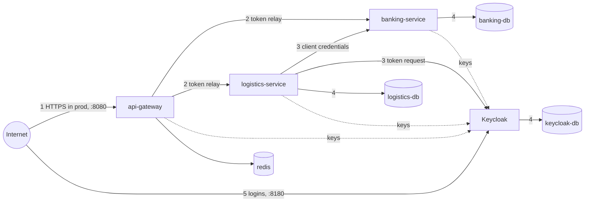

# Threat model (Phase 3)

STRIDE per trust boundary. Every threat names the control that stops it and the test or check that proves the
control works. "Residual" is what remains, and where it is addressed.

## 1. Internet to gateway

| STRIDE | Threat | Control | Proof |
| --- | --- | --- | --- |
| Spoofing | Request without a token, or with a forged, expired, wrongly signed or wrong-audience token | Resource server: RS256 only, issuer, audience `api-gateway`, lifetime (ADR 0017) | `GatewaySecurityTest.tokensThatAreNotExactlyRightAre401` (unknown key, other issuer, other audience, expired, HS256, `alg: none`) |
| Spoofing | Client sends `X-User-Id`, `X-Org-Id`, `X-Roles` to impersonate | Forgeable identity headers stripped before routing; services never read identity from headers | `GatewaySecurityTest.forgedIdentityHeadersAreStrippedAndTheTokenIsRelayedUnchanged` |
| Tampering | Oversized or slow bodies to exhaust memory | 1 MB body limit, 15 s response timeout (ADR 0015) | `GatewayEdgeTest` |
| Repudiation | Customer denies a transfer | Actor on every journal entry and hold, request id end to end (ADR 0020) | `AuthorisationMatrixTest.everyMoneyMovementRecordsWhoMadeItAndOnlyStaffSeeIt` (banking) |
| Information disclosure | Error bodies leak internals; 401 explains why a token failed | RFC 9457 problems without stack traces; `WWW-Authenticate` with an error code only | `GatewayProblemHandlerTest`, `GatewaySecurityTest` |
| Information disclosure | Public tracking leaks customer data | Tracking view without parties, payer or values (ADR 0009) | smoke test `expect .shipper ""` |
| Denial of service | A caller floods money-moving routes | Per-caller Redis token buckets, fail closed (ADR 0017) | `RateLimitTest`, `RateLimitRedisDownTest` |
| Denial of service | Forged key ids make the gateway hammer Keycloak | Unknown key ids refetch at most once per 30 s | `IssuerOutageTest.unknownKeyIdsDoNotRefetchTheKeysAgainWithinTheMinimumInterval` |
| Elevation of privilege | A customer calls an operator route | Edge role rules, then the service's own rules | `GatewaySecurityTest.coarseRoleRulesAtTheEdge` |

Residual: plain HTTP in compose. Production terminates TLS in front of the gateway (ADR 0019).

## 2. Gateway to services

| STRIDE | Threat | Control | Proof |
| --- | --- | --- | --- |
| Spoofing | A container on the network calls a service directly with forged identity | Each service validates the token itself, for its own audience (ADR 0017) | both `AuthorisationMatrixTest`s: every endpoint anonymous is 401 |
| Spoofing | A carrier's token used against banking directly | Carrier tokens have no `banking-service` audience (ADR 0016) | `KeycloakRealmIntegrationTest.aCarrierTokenNamesTheGatewayAndLogisticsButNeverBanking` |
| Elevation of privilege | BOLA: a customer changes an id to reach another tenant's object | Ownership checked on the loaded object; foreign is 404 (ADR 0018) | both `AuthorisationMatrixTest`s (231 cases) |
| Information disclosure | Lists include other tenants' shipments | Visibility in the query | `AuthorisationMatrixTest.listsOnlyShowWhatTheCallerMaySee` |
| Tampering | Idempotency key reuse across tenants returns another tenant's response | Keys scoped to the caller (ADR 0020) | `AuthorisationMatrixTest.sameKeyFromTwoTenantsIs...` (both services) |
| Denial of service | Keycloak down makes services answer 500 or 401 | 503 `issuer-unavailable` when keys cannot be fetched | `IssuerOutageTest`; `IssuerOutageFilter` in both services |

Residual: no mTLS between containers locally; Phase 7.

## 3. logistics-service to banking-service, and to Keycloak

| STRIDE | Threat | Control | Proof |
| --- | --- | --- | --- |
| Spoofing | Anyone on the network authorises or captures holds | Holds need logistics' token with scope `banking.holds` (ADR 0019) | banking `AuthorisationMatrixTest` hold rows: every other caller 403 |
| Elevation of privilege | A booking reserves another organisation's money | Hold carries `payerOrganizationId`; banking refuses an account it does not own | `HoldIntegrationTest`, logistics `AuthorisationMatrixTest.theHoldIsChargedToTheOrganisationThatBooked...` |
| Tampering | Lost responses lead to duplicate holds | Deterministic idempotency keys, outbox, replay (ADR 0012) | `BankingFaultInjectionTest` |
| Denial of service | Keycloak down stops payments | Commands stay PENDING, no attempt charged, retried later | `BankingFaultInjectionTest.keycloakDownWhileLogisticsNeedsAFreshToken...` |
| Information disclosure | Client secret leaks from config | Secret file mounted as compose secret; no default (ADR 0019) | `RequiredSecretsTest`, gitleaks in CI |

## 4. Services to databases

| STRIDE | Threat | Control | Proof |
| --- | --- | --- | --- |
| Information disclosure | Database reachable from the host or the internet | No database port published by default; `--profile debug` only | CI `Default stack starts` checks 5441 and 5442 are closed |
| Tampering | A bug or an attacker with SQL access rewrites history | Append-only triggers on postings, journal entries, extensions, checkpoints; actor triggers | `JournalIntegrationTest`, `HoldIntegrationTest.extensionHistoryIsAppendOnly`, `AuthorisationMatrixTest.aJournalEntryWithoutAnActorIsRefusedByTheDatabase` |
| Tampering | A forged balance checkpoint | Reconciliation recomputes the latest checkpoint | `SystemBalanceCheckpointsIntegrationTest.aTamperedCheckpointIsADiscrepancy` |
| Spoofing | Default database passwords | Generated passwords, `POSTGRES_PASSWORD_FILE` | `RequiredSecretsTest.theRealConfigurationHasNoDefaultSecret` |

Residual: one database user per service owns its schema; separate migration and runtime roles are Phase 7.

## 5. Keycloak

| STRIDE | Threat | Control | Proof |
| --- | --- | --- | --- |
| Spoofing | Password guessing | Brute-force lockout, temporary (5 failures, up to 15 min) (ADR 0016) | realm file |
| Spoofing | Password grant used to bypass the login page | No client has the password grant | `KeycloakRealmIntegrationTest.thereIsNoPasswordGrant` |
| Elevation of privilege | Built-in roles leak into tokens | `fullScopeAllowed: false`, scope mappings of the four roles only | `KeycloakRealmIntegrationTest` (logistics token has no roles) |
| Tampering | A long-lived token keeps working after a role change | 5-minute access tokens, single-use refresh tokens | `KeycloakRealmIntegrationTest.logisticsGetsATokenForBankingOnlyWithItsHoldsScope` (lifetime 300 s) |
| Information disclosure | Realm secrets in git | Placeholders resolved from `secrets/keycloak.env` | gitleaks |

Residual: Keycloak's admin console is reachable on 8180 locally; production exposes only the realm's public
endpoints and keeps the admin console on an internal network.
